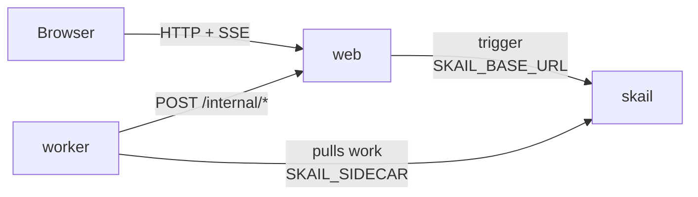

# skail saga (.NET 8)

[Português (Brasil)](README.pt-BR.md)

A skail function closes an order: it reserves the stock, charges the card and issues the invoice. When a step does not work out, it undoes the previous ones in reverse order. A web page places the orders and shows each effect on the simulated services as it happens.

The demo covers three topics of the [skail docs](https://docs.skail.dev) (in Portuguese):

- the [saga](https://docs.skail.dev/construa/como-fazer/padroes-e-antipadroes/saga) pattern: each step and each compensation is a command;
- [handling errors and undoing steps](https://docs.skail.dev/construa/como-fazer/tratar-erros-e-desfazer-passos): an `if` for what the business refuses, a `try/catch` for a service that stayed down;
- [retries and idempotency](https://docs.skail.dev/construa/conceitos/retries-e-idempotencia): the charge is retried with the order id as the idempotency key.

## How it works



- **worker** (`src/SkailSaga.Worker`): the function `CloseOrder(order)` and its commands. `ReserveStock`, `ChargeCard` and `IssueInvoice` are the steps; `RefundCharge` and `ReleaseStock` undo them; `NotifyCustomer` and `RecordResult` tell the customer and the page how the order ended.
- **web** (`src/SkailSaga.Web`): the static page, the order API, the page API and the simulated services (stock, payment gateway, invoice issuer and customer e-mail), in memory. It starts one run per order (trigger) and streams the state to the page (SSE).
- **contracts** (`src/SkailSaga.Contracts`): types and constants used by the worker and the web app.

In your system, the simulated services would be your stock service, payment gateway, invoice issuer and customer messaging. Here they live in the web app, so the page can show every effect in the order it happened.

The function only orchestrates and leaves the I/O to the commands. What the business refuses comes back as a result, and the function handles it with an `if`. A service that is still down after the retries throws, and the `catch` turns it into a refusal; it leaves out `SkailNonDeterministicException`, which means the code and the run history diverged. Simplified from [`OrderFunctions.cs`](src/SkailSaga.Worker/OrderFunctions.cs), which also notifies the customer on each path:

```csharp
Charge charge;
try
{
    charge = await commands.ChargeCard(order.Id, order.Amount);
}
catch (Exception ex) when (ex is not SkailNonDeterministicException)
{
    charge = Charge.Declined("payment gateway down");   // every attempt failed
}

if (!charge.Approved)
{
    await commands.ReleaseStock(reservation.Id!);
    return await commands.RecordResult(order.Id, SagaResults.PaymentDeclined);
}

TaxInvoice invoice;
try
{
    invoice = await commands.IssueInvoice(order.Id, order.Product, order.Amount);
}
catch (Exception ex) when (ex is not SkailNonDeterministicException)
{
    invoice = TaxInvoice.Rejected("invoice issuer down");
}

if (!invoice.Authorized)
{
    await commands.RefundCharge(charge.Id!);         // reverse order: the refund first,
    await commands.ReleaseStock(reservation.Id!);    // then the stock
    return await commands.RecordResult(order.Id, SagaResults.CancelledWithRefund);
}
```

`ChargeCard` has `retryCount: 3`. A timeout or a network error throws and skail runs the command again; the order id is the idempotency key, so a new attempt does not charge twice. A declined card comes back as a result, because another attempt would not change the bank's answer. The compensations are commands too: if the worker stops in the middle of them, the ones that already ran do not run again.

The function receives the order without the card. The web app keeps the card on file and the gateway charges it by order id, so the card number never goes into the run history or the Monitor (see [passing data between function and commands](https://docs.skail.dev/construa/como-fazer/passar-dados-entre-funcao-e-commands)).

## The four paths

The page has one button per path. Each one places an order and starts a `CloseOrder` run.

| Button | Order | Steps on the page | Result |
|---|---|---|---|
| **Confirmed** | 1 Monitor | reserved, timeout, charged, invoice issued | `confirmed` |
| **Card declined** | 1 Monitor, card `…0002` | reserved, timeout, declined, ↩ stock released | `payment declined` |
| **Invoice rejected** | 2 Cabo HDMI | reserved, timeout, charged, invoice rejected, ↩ refunded, ↩ stock released | `cancelled with refund` |
| **Out of stock** | 6 Monitors (5 in stock) | out of stock | `out of stock` |

Every path ends by notifying the customer. The simulated services are set up for these paths: the first charge attempt of every order times out, so the skail retry shows up; a card ending in `0002` is declined; only `Monitor` and `Teclado` have a tax registration, so any other product gets its invoice rejected. **Reset demo** puts the stock back and clears the orders.

The page calls the order API, which you can also call from a terminal:

```bash
curl -X POST localhost:8080/api/orders -H 'Content-Type: application/json' \
  -d '{"product":"Monitor","quantity":1,"amount":1200,"card":"4111111111111111"}'
```

The API answers with `orderId` and `taskId`; the `taskId` is the run id in skail. If skail does not accept the trigger, the API answers `502` and the order shows as **Not accepted**.

## How it connects to skail

| Service | Variable | Used for |
|---|---|---|
| worker | `SKAIL_SIDECAR` | Connects the function to your environment and receives its work. |
| web | `SKAIL_BASE_URL` | Starts runs through the skail HTTP API. |

Both use the same `SKAIL_WORKLOAD`, `SKAIL_NAMESPACE` and `SKAIL_KEY`. The web app makes one call per order:

```http
POST {SKAIL_BASE_URL}/api/v1/trigger/{name}/{version}/CloseOrder/{taskId}
[{"Id": "P-10", "Product": "Monitor", "Quantity": 1, "Amount": 1200}]
```

`{name}` and `{version}` come from `SKAIL_WORKLOAD` (`name:version`). The body is the list of the function arguments, with the property names as C# declares them. Each call sends the key in `skail-key` and in `Authorization: Bearer`, plus the `Skail-namespace` header, as described in [authentication](https://docs.skail.dev/referencia/api-http/autenticacao). `429`, `5xx` and network errors are retried with the same task id. `401` and `403` are not retried: check `SKAIL_KEY` and `SKAIL_NAMESPACE`.

The browser never calls skail. It only talks to the web app, so the key stays on the server.

## Requirements

- .NET 8 SDK
- podman or docker
- PowerShell 7+ (`pwsh`), only if you use `scripts/run.ps1` instead of `scripts/run.sh`
- A skail environment with the workload from `SKAIL_WORKLOAD` registered (`demosaga:v1.0.0` by default). The [Quickstart](https://docs.skail.dev/comece-aqui/quickstart) shows how to get an account, create the environment and register the workload.
- A current browser (Chrome/Edge 111+, Firefox 113+, Safari 16.2+). The page uses Server-Sent Events, CSS `color-mix()` and modern JavaScript.

## Configure

```bash
cp .env.example .env     # .env holds the key and is ignored by git
```

Fill in `SKAIL_WORKLOAD` (exactly as registered in the portal), `SKAIL_NAMESPACE`, `SKAIL_KEY`, `SKAIL_SIDECAR` and `SKAIL_BASE_URL` with the values of your environment.

## Run with podman or docker

```bash
scripts/run.sh up        # builds both images and starts web + worker
scripts/run.sh logs
scripts/run.sh down
```

`CONTAINER_ENGINE=docker` forces docker. On Windows, or anywhere with PowerShell 7+, run `pwsh scripts/run.ps1 <command>` with the same commands; `$env:CONTAINER_ENGINE = "docker"` forces docker.

Open <http://localhost:8080> and press one of the four buttons.

### See the durability

1. Press **Confirmed** and wait for the gateway timeout on the page.
2. The new charge attempt comes about 15 seconds later. Before it, run `scripts/run.sh kill-worker`. It kills the worker with SIGKILL, like a crash; the web app keeps the page state.
3. Run `scripts/run.sh start-worker`. The run continues from the charge: the stock reservation does not run again, and the card is charged once.

In the portal, open the [Monitor](https://docs.skail.dev/referencia/portal/monitor) of your environment and search for the `taskId`. On the **Confirmed** path, the run lists `ReserveStock`, `ChargeCard`, `IssueInvoice`, `NotifyCustomer` and `RecordResult`, each with its arguments and result. On the failing paths, `RefundCharge` and `ReleaseStock` come after the step that failed, in reverse order. The gateway timeout shows up as a `System.Net.Http.HttpRequestException` line just above `ChargeCard`, with the message `Web app answered 504 to the charge`, and the **Retries** column of the run shows 1. The card number does not show up anywhere.

Compare **Duration** with **E2E Duration**. In a run on the **Invoice rejected** path, E2E Duration was 16.4 s and Duration was 406 ms: almost all the time was the wait before the new charge attempt, which does not use the worker. Every path ends as **Completed**, because the function returns normally; its result says how the order ended (`"cancelled with refund"`, for example).

## VS Code

Open the folder and accept the recommended extensions (C# Dev Kit).

- `Ctrl+Shift+B` builds, the *test* task runs the tests and the `containers: up/down/logs/kill-worker/start-worker` tasks call `scripts/run.sh`.
- The **Worker + Web** debug configuration starts both projects reading `.env`, and a breakpoint inside a command works. Outside containers, the worker reaches the web app on `localhost` (`WEB_BASE_URL`, set in `launch.json`).

## Tests

```bash
dotnet test
```

The unit tests cover the contracts, the HTTP calls of the worker, the simulated services, the calls to skail (trigger and retries) and the web API with SSE. They need neither network nor skail.

## Notes

- The simulated services live in memory, in the web app. Restarting it loses the orders and puts the stock back, but skail does not run again what it already finished. Five confirmed Monitors sell out the stock; **Reset demo** starts over.
- The card numbers are test numbers. Never type a real card in a demo.
- A gateway or invoice issuer that fails on every attempt becomes a refusal (`payment gateway down`, `invoice issuer down`), and the function undoes what it did. The page has no button for this.
- A saga is not a transaction: between the charge and the refund, the customer was charged. What the function guarantees is that the compensations run, in reverse order, even if the worker stops in the middle.
- The `/internal/*` routes, which the worker calls, have no authentication. That is fine for a local demo; protect them before using the pattern in production.
- Workers with the same `SKAIL_WORKLOAD` on the same environment share the same runs: use one workload (or environment) per person.

## License

[Apache-2.0](LICENSE)
