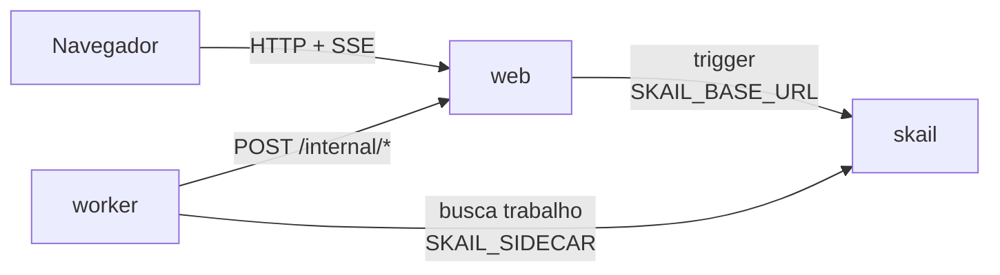

# skail saga (.NET 8)

[English](README.md)

Uma function do skail fecha um pedido: reserva o estoque, cobra o cartão e emite a nota fiscal. Quando um passo não dá certo, ela desfaz os anteriores em ordem inversa. Uma página web faz os pedidos e mostra cada efeito nos serviços simulados assim que ele acontece.

A demo mostra três tópicos da [documentação do skail](https://docs.skail.dev):

- o padrão [saga](https://docs.skail.dev/construa/como-fazer/padroes-e-antipadroes/saga): cada passo e cada compensação é um command;
- [tratar erros e desfazer passos](https://docs.skail.dev/construa/como-fazer/tratar-erros-e-desfazer-passos): um `if` para o que o negócio recusa, um `try/catch` para um serviço que continuou fora do ar;
- [retries e idempotência](https://docs.skail.dev/construa/conceitos/retries-e-idempotencia): a cobrança é repetida com o id do pedido como chave de idempotência.

## Como funciona



- **worker** (`src/SkailSaga.Worker`): a function `CloseOrder(order)` e os commands dela. `ReserveStock`, `ChargeCard` e `IssueInvoice` são os passos; `RefundCharge` e `ReleaseStock` desfazem esses passos; `NotifyCustomer` e `RecordResult` avisam o cliente e a página de como o pedido terminou.
- **web** (`src/SkailSaga.Web`): a página estática, a API de pedidos, a API da página e os serviços simulados (estoque, gateway de pagamento, emissor de nota e e-mail ao cliente), em memória. Inicia uma execução por pedido (trigger) e transmite o estado para a página (SSE).
- **contracts** (`src/SkailSaga.Contracts`): tipos e constantes usados pelo worker e pelo web.

No seu sistema, os serviços simulados seriam o seu serviço de estoque, gateway de pagamento, emissor de nota e envio de mensagens ao cliente. Aqui eles ficam no web, para a página mostrar cada efeito na ordem em que aconteceu.

A function só orquestra e deixa o I/O para os commands. O que o negócio recusa volta como resultado, e a function trata com um `if`. Um serviço que continua fora do ar depois das novas tentativas lança exceção, e o `catch` transforma isso em recusa; ele deixa de fora o `SkailNonDeterministicException`, que indica que o código e o histórico da execução divergiram. O trecho abaixo é uma versão simplificada do [`OrderFunctions.cs`](src/SkailSaga.Worker/OrderFunctions.cs), que também avisa o cliente em cada caminho:

```csharp
Charge charge;
try
{
    charge = await commands.ChargeCard(order.Id, order.Amount);
}
catch (Exception ex) when (ex is not SkailNonDeterministicException)
{
    charge = Charge.Declined("payment gateway down");   // every attempt failed
}

if (!charge.Approved)
{
    await commands.ReleaseStock(reservation.Id!);
    return await commands.RecordResult(order.Id, SagaResults.PaymentDeclined);
}

TaxInvoice invoice;
try
{
    invoice = await commands.IssueInvoice(order.Id, order.Product, order.Amount);
}
catch (Exception ex) when (ex is not SkailNonDeterministicException)
{
    invoice = TaxInvoice.Rejected("invoice issuer down");
}

if (!invoice.Authorized)
{
    await commands.RefundCharge(charge.Id!);         // reverse order: the refund first,
    await commands.ReleaseStock(reservation.Id!);    // then the stock
    return await commands.RecordResult(order.Id, SagaResults.CancelledWithRefund);
}
```

O `ChargeCard` tem `retryCount: 3`. Um timeout ou um erro de rede lança exceção e o skail roda o command de novo; o id do pedido é a chave de idempotência, então uma nova tentativa não cobra duas vezes. Um cartão recusado volta como resultado, porque outra tentativa não mudaria a resposta do banco. As compensações também são commands: se o worker parar no meio delas, as que já rodaram não rodam de novo.

A function recebe o pedido sem o cartão. O web guarda o cartão do pedido e o gateway cobra pelo id do pedido, então o número do cartão nunca entra no histórico da execução nem no Monitor (ver [passar dados entre função e commands](https://docs.skail.dev/construa/como-fazer/passar-dados-entre-funcao-e-commands)).

## Os quatro caminhos

A página tem um botão por caminho. Cada botão faz um pedido e inicia uma execução de `CloseOrder`.

| Botão | Pedido | Passos na página | Resultado |
|---|---|---|---|
| **Confirmed** | 1 Monitor | reserva, timeout, cobrança, nota emitida | `confirmed` |
| **Card declined** | 1 Monitor, cartão `…0002` | reserva, timeout, recusa, ↩ estoque liberado | `payment declined` |
| **Invoice rejected** | 2 Cabo HDMI | reserva, timeout, cobrança, nota recusada, ↩ estorno, ↩ estoque liberado | `cancelled with refund` |
| **Out of stock** | 6 Monitores (5 em estoque) | sem estoque | `out of stock` |

Todo caminho termina avisando o cliente. Os serviços simulados foram montados para esses caminhos: a primeira tentativa de cobrança de cada pedido dá timeout, para o retry do skail aparecer; um cartão terminado em `0002` é recusado; só `Monitor` e `Teclado` têm cadastro fiscal, então qualquer outro produto tem a nota recusada. O **Reset demo** devolve o estoque e limpa os pedidos.

A página chama a API de pedidos, que você também pode chamar pelo terminal:

```bash
curl -X POST localhost:8080/api/orders -H 'Content-Type: application/json' \
  -d '{"product":"Monitor","quantity":1,"amount":1200,"card":"4111111111111111"}'
```

A API responde com `orderId` e `taskId`; o `taskId` é o id da execução no skail. Se o skail não aceitar o trigger, a API responde `502` e o pedido aparece como **Not accepted**.

## Como conecta ao skail

| Serviço | Variável | Para quê |
|---|---|---|
| worker | `SKAIL_SIDECAR` | Conecta a function ao seu environment e recebe o trabalho dela. |
| web | `SKAIL_BASE_URL` | Inicia execuções pela API HTTP do skail. |

Os dois usam os mesmos `SKAIL_WORKLOAD`, `SKAIL_NAMESPACE` e `SKAIL_KEY`. O web faz uma chamada por pedido:

```http
POST {SKAIL_BASE_URL}/api/v1/trigger/{nome}/{versao}/CloseOrder/{taskId}
[{"Id": "P-10", "Product": "Monitor", "Quantity": 1, "Amount": 1200}]
```

`{nome}` e `{versao}` vêm de `SKAIL_WORKLOAD` (`nome:versao`). O body é a lista de argumentos da function, com os nomes das propriedades como o C# declara. Cada chamada manda a chave em `skail-key` e em `Authorization: Bearer`, mais o header `Skail-namespace`, como descrito em [autenticação](https://docs.skail.dev/referencia/api-http/autenticacao). `429`, `5xx` e erros de rede são repetidos com o mesmo task id. `401` e `403` não são repetidos: confira `SKAIL_KEY` e `SKAIL_NAMESPACE`.

O navegador nunca chama o skail. Ele só fala com o web, então a chave fica no servidor.

## Requisitos

- SDK do .NET 8
- podman ou docker
- PowerShell 7+ (`pwsh`), só se você usar o `scripts/run.ps1` em vez do `scripts/run.sh`
- Um environment do skail com o workload de `SKAIL_WORKLOAD` cadastrado (`demosaga:v1.0.0` por padrão). O [Quickstart](https://docs.skail.dev/comece-aqui/quickstart) mostra como pedir a conta, criar o environment e cadastrar o workload.
- Um navegador atual (Chrome/Edge 111+, Firefox 113+, Safari 16.2+). A página usa Server-Sent Events, `color-mix()` do CSS e JavaScript moderno.

## Configurar

```bash
cp .env.example .env     # o .env guarda a chave e é ignorado pelo git
```

Preencha `SKAIL_WORKLOAD` (exatamente como está cadastrado no portal), `SKAIL_NAMESPACE`, `SKAIL_KEY`, `SKAIL_SIDECAR` e `SKAIL_BASE_URL` com os valores do seu environment.

## Rodar com podman ou docker

```bash
scripts/run.sh up        # builda as duas imagens e sobe web + worker
scripts/run.sh logs
scripts/run.sh down
```

`CONTAINER_ENGINE=docker` força o docker. No Windows, ou em qualquer sistema com PowerShell 7+, rode `pwsh scripts/run.ps1 <comando>` com os mesmos comandos; `$env:CONTAINER_ENGINE = "docker"` força o docker.

Abra <http://localhost:8080> e clique em um dos quatro botões.

### Ver a durabilidade

1. Clique em **Confirmed** e espere o timeout do gateway aparecer na página.
2. A nova tentativa de cobrança vem uns 15 segundos depois. Antes dela, rode `scripts/run.sh kill-worker`. Ele mata o worker com SIGKILL, como numa queda, e o web mantém o estado da página.
3. Rode `scripts/run.sh start-worker`. A execução continua da cobrança: a reserva de estoque não roda de novo e o cartão é cobrado uma vez só.

No portal, abra o [Monitor](https://docs.skail.dev/referencia/portal/monitor) do seu environment e procure pelo `taskId`. No caminho **Confirmed**, a execução lista `ReserveStock`, `ChargeCard`, `IssueInvoice`, `NotifyCustomer` e `RecordResult`, cada um com argumentos e resultado. Nos caminhos com falha, `RefundCharge` e `ReleaseStock` vêm depois do passo que falhou, em ordem inversa. O timeout do gateway aparece como uma linha `System.Net.Http.HttpRequestException` logo acima do `ChargeCard`, com a mensagem `Web app answered 504 to the charge`, e a coluna **Retries** da execução mostra 1. O número do cartão não aparece em lugar nenhum.

Compare **Duration** com **E2E Duration**. Numa execução do caminho **Invoice rejected**, o E2E Duration foi de 16,4 s e o Duration de 406 ms: quase todo o tempo foi a espera até a nova tentativa de cobrança, que não ocupa o worker. Todo caminho termina como **Completed**, porque a function retorna normalmente; o resultado dela diz como o pedido terminou (`"cancelled with refund"`, por exemplo).

## VS Code

Abra a pasta e aceite as extensões recomendadas (C# Dev Kit).

- `Ctrl+Shift+B` compila, a task *test* roda os testes e as tasks `containers: up/down/logs/kill-worker/start-worker` chamam o `scripts/run.sh`.
- A configuração de debug **Worker + Web** sobe os dois projetos lendo o `.env`, e um breakpoint dentro de um command funciona. Fora de container, o worker acessa o web em `localhost` (`WEB_BASE_URL`, definido no `launch.json`).

## Testes

```bash
dotnet test
```

Os testes unitários cobrem os contratos, as chamadas HTTP do worker, os serviços simulados, as chamadas ao skail (trigger e novas tentativas) e a API web com SSE. Eles não precisam de rede nem do skail.

## Observações

- Os serviços simulados ficam em memória, no web. Reiniciar o web perde os pedidos e devolve o estoque, mas o skail não roda de novo o que já terminou. Cinco Monitores confirmados esgotam o estoque; o **Reset demo** recomeça.
- Os números de cartão são de teste. Nunca digite um cartão real numa demo.
- Um gateway ou emissor de nota que falha em todas as tentativas vira uma recusa (`payment gateway down`, `invoice issuer down`), e a function desfaz o que fez. A página não tem botão para isso.
- Uma saga não é uma transação: entre a cobrança e o estorno, o cliente ficou cobrado. O que a function garante é que as compensações rodam, em ordem inversa, mesmo que o worker pare no meio.
- As rotas `/internal/*`, que o worker chama, não têm autenticação. Para uma demo local isso basta; proteja essas rotas antes de usar o padrão em produção.
- Workers com o mesmo `SKAIL_WORKLOAD` no mesmo environment dividem as mesmas execuções: use um workload (ou environment) por pessoa.

## Licença

[Apache-2.0](LICENSE)
