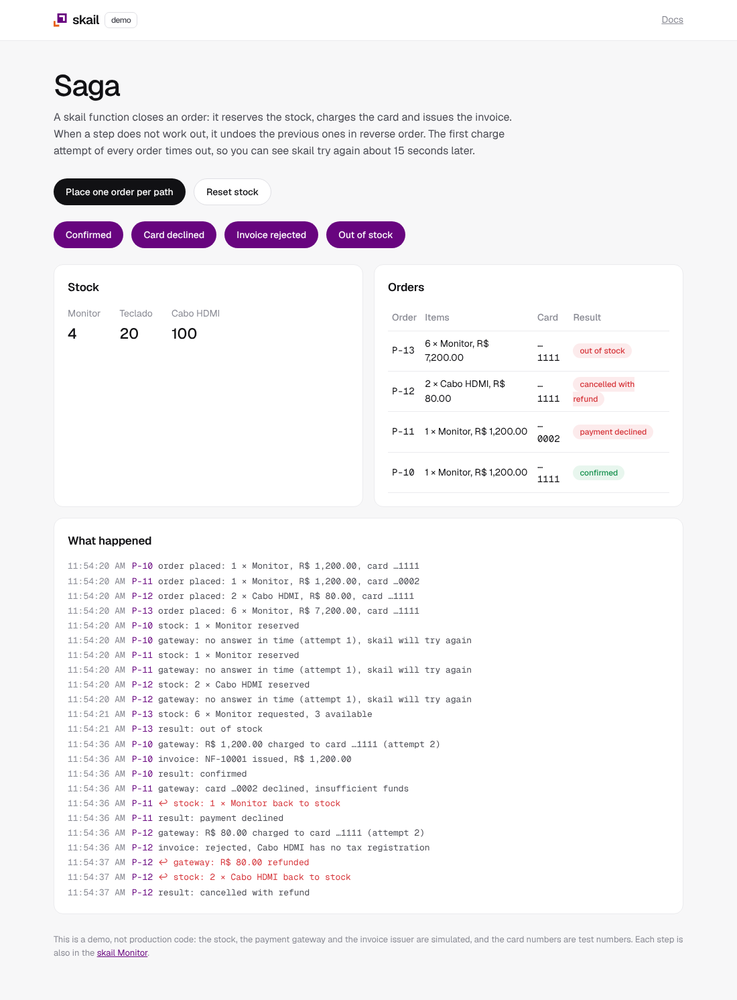

# skail saga (.NET 8)

[English](README.md)

Um app com uma function do skail que fecha um pedido: reserva o estoque, cobra o cartão e emite a nota fiscal. Quando um passo não dá certo, ela desfaz os anteriores em ordem inversa. Você cria os pedidos numa página que o app serve em http://localhost:8080.

Ele mostra três recursos do skail:

- o padrão **saga**: cada passo e cada compensação é um command, e as compensações rodam em ordem inversa;
- **novas tentativas automáticas**: a primeira tentativa de cobrança de todo pedido dá timeout, e o skail tenta de novo sozinho;
- **durabilidade**: feche o app no meio de um pedido, abra de novo e o pedido continua de onde estava, sem reservar o estoque nem cobrar o cartão duas vezes.

## Requisitos

- Um destes: [Docker](https://docs.docker.com/get-docker/), [Podman](https://podman.io/docs/installation) ou o [SDK do .NET 8](https://dotnet.microsoft.com/download/dotnet/8.0) (ou mais novo). O script de execução usa o primeiro que encontrar.
- Um environment do skail com um workload registrado para o `SKAIL_WORKLOAD` do `.env` (`demosaga:v1.0.0` por padrão). O [Quickstart](https://docs.skail.dev/comece-aqui/quickstart) mostra como criar a conta, o environment e o workload.

O projeto usa o `Skail.Platform.Runtime` **2.3.0-rc.4**.

## Rodar

```bash
cp .env.example .env      # preencha SKAIL_SIDECAR, SKAIL_NAMESPACE e SKAIL_KEY (portal > Environments & keys > Connect)
scripts/run.sh            # depois abra http://localhost:8080
scripts/run.sh resume     # mantém o estado que o app deixou: termina os pedidos que ficaram no meio
```

No Windows, no PowerShell: `copy .env.example .env` e depois `powershell -ExecutionPolicy Bypass -File scripts\run.ps1`, com os mesmos argumentos. O script funciona no Windows PowerShell que já vem no Windows; não precisa do PowerShell 7.

O script roda a demo com o que a máquina tiver: Docker, depois Podman, depois o SDK do .NET. Se não achar nenhum, ele diz o que instalar. Sem o script, os comandos são `dotnet run` (com os argumentos depois de `--`, como em `dotnet run -- <argumento>`).



Cada passo dos commands aparece na página, em **What happened**, e no console. As linhas com ↩ são compensações. A nova tentativa de cobrança vem cerca de 15 segundos depois do timeout. A página se atualiza sozinha a cada segundo.

## Os quatro caminhos

| O que você clica | Pedido | O que acontece | Resultado |
|---|---|---|---|
| **Confirmed** | 1 Monitor | reservado, timeout, cobrado, nota emitida | `confirmed` |
| **Card declined** | 1 Monitor, cartão `…0002` | reservado, timeout, recusado, ↩ estoque liberado | `payment declined` |
| **Invoice rejected** | 2 Cabo HDMI | reservado, timeout, cobrado, nota rejeitada, ↩ estornado, ↩ estoque liberado | `cancelled with refund` |
| **Out of stock** | 6 Monitores (5 em estoque) | sem estoque | `out of stock` |

**Place one order per path** cria os quatro de uma vez, e **Reset stock** devolve o estoque. Os serviços simulados estão preparados para esses caminhos: a primeira tentativa de cobrança de todo pedido dá timeout, um cartão terminado em `0002` é recusado, e só `Monitor` e `Teclado` têm cadastro fiscal, então qualquer outro produto tem a nota rejeitada.

## Como funciona

O app faz três coisas no mesmo processo: serve a página, hospeda o worker que executa a function (`builder.UseSkail()`) e cria os pedidos e inicia uma execução por pedido pela API HTTP do skail. Os serviços simulados (estoque, gateway de pagamento e emissor de nota) ficam no mesmo processo e registram cada efeito numa linha do tempo que a página mostra.

```http
POST {SKAIL_SIDECAR}/api/v1/trigger/demosaga/v1.0.0/CloseOrder/{runId}
[{"Id": "P-10", "Product": "Monitor", "Quantity": 1, "Amount": 1200}]
```

A function, em [`OrderFunctions.cs`](OrderFunctions.cs):

```csharp
[SkailFunction]
public async SkailTask<string> CloseOrder(Order order)
{
    var reservation = await ReserveStock(order.Id, order.Product, order.Quantity);
    if (!reservation.Confirmed)
        return await ReportResult(order.Id, SagaResults.OutOfStock);

    var charge = await ChargeCard(order.Id, order.Amount);
    if (!charge.Approved)
    {
        await ReleaseStock(reservation.Id!);
        return await ReportResult(order.Id, SagaResults.PaymentDeclined);
    }

    var invoice = await IssueInvoice(order.Id, order.Product, order.Amount);
    if (!invoice.Authorized)
    {
        await RefundCharge(charge.Id!);          // reverse order: the refund first,
        await ReleaseStock(reservation.Id!);     // then the stock
        return await ReportResult(order.Id, SagaResults.CancelledWithRefund);
    }

    return await ReportResult(order.Id, SagaResults.Confirmed);
}
```

- O que o negócio recusa (falta de estoque, cartão recusado, nota rejeitada) volta como resultado, e a function trata com um `if`. Outra tentativa não mudaria a resposta, então não é exceção.
- Um timeout do gateway lança exceção, e o skail roda o `ChargeCard` de novo (`retryCount: 3`). O id do pedido é a chave de idempotência, então uma nova tentativa não cobra duas vezes.
- As compensações (`RefundCharge`, `ReleaseStock`) também são commands: se o app parar no meio delas, as que já rodaram não rodam de novo.
- A function recebe o pedido sem o cartão. A loja simulada guarda o cartão e o gateway cobra pelo id do pedido, então o número do cartão nunca entra no histórico da execução nem no Monitor.

| Arquivo | O que tem |
|---|---|
| `OrderFunctions.cs` | A function e os commands dela. |
| `Demo/SimulatedServices.cs` | O estoque, o gateway de pagamento e o emissor de nota simulados. |
| `Demo/DemoOrders.cs` | O pedido de cada caminho. |
| `Demo/OrderDesk.cs` | Cria os pedidos da página e inicia uma execução para cada um. |
| `Demo/Timeline.cs` | A linha do tempo dos passos, para o console e a página. |
| `Page/index.html` | A página, com a marca do skail. |
| `Skail/SkailApiClient.cs` | O trigger pela API HTTP do skail. |
| `Program.cs` | Lê o `.env` e o argumento, serve a página e a API dela, e liga tudo. |
| `scripts/run.sh`, `scripts/run.ps1`, `Dockerfile` | Rodam a demo com Docker, Podman ou o .NET, o que houver na máquina. |

## Veja a durabilidade

1. Rode `scripts/run.sh`, abra a página, clique em **Confirmed** e espere o `gateway: no answer in time`.
2. Antes da nova tentativa, cerca de 15 segundos depois, aperte **Ctrl+C**. O app fecha; a execução continua no skail.
3. Rode `scripts/run.sh resume` e abra a página de novo. O pedido continua da cobrança: o estoque não é reservado de novo, e o cartão é cobrado uma vez só.

Os serviços simulados guardam o estado em `.saga-demo.json`, então ele sobrevive ao reinício. `scripts/run.sh` sem `resume` começa do zero, com o estoque cheio.

No portal, abra o [Monitor](https://docs.skail.dev/referencia/portal/monitor) do seu environment e clique numa execução: no caminho **Invoice rejected**, o `RefundCharge` e o `ReleaseStock` vêm depois do `IssueInvoice`, em ordem inversa, e o timeout aparece como uma tentativa com falha do `ChargeCard`. O número do cartão não aparece em lugar nenhum.

## Observações

- Uma saga não é uma transação: entre a cobrança e o estorno, o cliente foi cobrado. O que a function garante é que as compensações rodam, em ordem inversa, mesmo que o app pare no meio.
- Aqui os serviços simulados sempre respondem no fim. No seu sistema, um serviço pode ficar fora por mais tempo que as tentativas; veja [tratar erros e desfazer passos](https://docs.skail.dev/construa/como-fazer/tratar-erros-e-desfazer-passos) para desfazer os passos anteriores nesse caso.
- Apps rodando o mesmo `SKAIL_WORKLOAD` no mesmo environment dividem as mesmas execuções: use um workload (ou environment) por pessoa.

## Aviso

**Esta é uma demonstração, não é código de produção.** Ela existe só para mostrar como o [skail](https://docs.skail.dev) funciona e é fornecida "como está", sem garantia de nenhum tipo. O estoque, o gateway de pagamento e o emissor de nota são simulados, e os números de cartão são de teste: nunca use um cartão real nela.

## Licença

[Apache-2.0](LICENSE)
